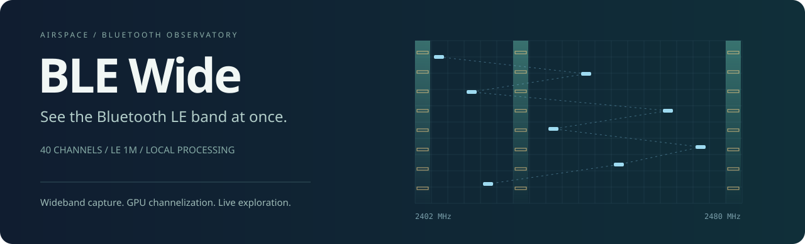

<p align="center">
  
</p>

<p align="center">
  <strong>40 channels. One capture. A clearer view of Bluetooth.</strong><br>
  Wideband LE 1M reception, GPU channelization, and a live browser observatory.
</p>

<p align="center">
  <a href="#quick-start">Quick start</a> ·
  <a href="#airspace-the-viewer">Explore the viewer</a> ·
  <a href="#how-it-works">Architecture</a> ·
  <a href="#performance-with-evidence">Performance</a> ·
  <a href="#project-status">Project status</a>
</p>

BLE Wide turns a wideband IQ stream into a live view of Bluetooth Low Energy activity across the entire band. Capture the three advertising channels and 37 data channels together, follow observed connections as they hop, and inspect packets alongside the spectrum that carried them.

**Airspace**, the included web viewer, brings connections, device discovery, packet inspection, and a frequency waterfall into one interface. Signal processing runs locally: Metal handles channelization on macOS, CPU workers decode channel streams, and the browser interprets packet contents.

Built for the [W1700K SDR project](https://github.com/BBekker/w1700k-sdr). This repository contains the **complete computer-side application**, including the receiver. Router firmware, the radio exporter, and hardware research live in the separate SDR repository.

## Airspace: the viewer

| Follow the conversation | Inspect the radio |
| --- | --- |
| **Connection timelines** with pan, zoom, setup packets, and channel-map updates | **Live waterfall** with automatic display levels and decoded-packet overlays |
| **Per-connection packet views** with payload bytes, signal and noise estimates, and grouped empty packets | **Device filters** that narrow connections, advertisements, and packet highlights together |
| **Browser-side protocol interpretation** for supported Link Layer, L2CAP, ATT, and Security Manager messages | **Automatic device names** collected from advertisements and scan responses |
| **Optional CRC-failure visibility** to inspect unsuccessful decoding attempts | **Capture health** showing missing samples, processing backlog, and transport status |

Select one or more devices in **Nearby devices** to focus the view. Matching advertisements receive high-contrast outlines in the waterfall; a visible-window packet count confirms what is being shown. Spectrum power continues to show the whole band.

The viewer retains the latest 50,000 packets. It distinguishes observed connection setups from connections joined midstream; inferred events are tracking estimates, not additional captured packets.

## Quick start

### 1. Build

Requirements: a C++17 compiler, single-precision FFTW, pkg-config, make, and Python 3.10+. Node.js runs the browser regression tests. Optional compiler-profile training requires Python 3.11+ and LLVM.

On macOS with Homebrew:

```sh
git clone https://github.com/BBekker/ble-wide.git
cd ble-wide
brew install fftw pkg-config llvm node
./tools/run make -j4
```

`tools/run` selects available Homebrew tools for the command without changing your shell settings. On Linux, install the corresponding FFTW development package and build tools, then run `make`. Linux uses the CPU channelizer; macOS also supports Metal and Accelerate. Current hardware validation is on an Apple M3 Pro.

### 2. Start reception

With the router **already configured and exporting** to this computer:

```sh
python3 -m airspace --bits 8 --backend metal --decode-threads 4
```

Open **[localhost:8076](http://127.0.0.1:8076/)**. The viewer manages both the sample receiver and decoder. Streaming decoding is the default. Use `--backend cpu` on Linux.

The example assumes a 160 Msps IQ8 export to `10.77.0.10`, over two UDP ports starting at 7700. For ordinary UDP reception, configure jumbo frames at both ends and use a 5 GbE link. Eight bits each for I and Q at 160 Msps is **2.56 Gb/s of sample data**, before framing overhead.

`--bind`, `--ports`, and `--bits` must match your source setup. `--bits` describes the stream to the viewer; it does not change the radio or exporter. The receiver detects the supported wire format and publishes normalized int16 IQ.

### 3. Choose your transport

| Mode | Behavior |
| --- | --- |
| `--transport auto` *(default)* | Prefer direct USB on the tested RTL8157; otherwise use UDP. A failed or declined USB attempt falls back to UDP. |
| `--transport udp` | Use the normal operating-system network path. |
| `--transport usb` | Require direct USB and report a failure instead of falling back. |
| `--stream /name` | Attach to an externally managed sample ring without claiming an adapter. |

Direct USB currently supports **macOS + RTL8157 revision `0x3000`**. Discovery is read-only and selects the adapter associated with `--bind`. Capture requires one macOS administrator authorization per viewer run; it installs no permanent service and requires no SIP or startup-security changes. Normal IP networking on that adapter is temporarily unavailable during takeover. Receiver details show the active transport and any fallback reason.

For an adapter with no stock-driver network interface, select its actual IORegistry location explicitly:

```sh
python3 -m airspace --backend metal --transport usb --usb-location 0x02200000
```

The location above is an example, not a universal device identifier. See the [USB implementation and hardware validation notes](receiver/usb/README.md) for initialization, permissions, diagnostics, and recovery limits.

### Coordinated router startup

From the **separate SDR checkout**, with router configuration already in place:

```sh
tools/macos/run python3 tools/iq4/start-mac.py --ble-repo ../ble-wide \
  --interface eth2 --bits 8 --blocks 2 --ports 2 --ble \
  --backend metal --decode-threads 4 --reuse-radio --seconds 86400
```

The launcher configures the capture session and coordinates startup/shutdown. It accepts `--ble-repo` or `W1700K_BLE_REPO`, defaulting to a sibling `ble-wide` checkout. Credentials and router configuration stay in the SDR repository.

## How it works

```text
W1700K radio export
        │
        ├── UDP / operating-system networking
        └── Direct RTL8157 USB / authorized capture helper
                     │
              w1700k-stream
        frame validation · ordering · loss accounting
                     │
              Shared-memory IQ ring
                     │
             w1700k-ble-wide
        Metal or CPU channelizer → channel decode workers
                     │
          Python connection tracker + event feed
                     │
              Airspace web viewer
        timelines · spectrum · browser-side PDU decoding
```

Reception and decoding run in separate processes so network/USB work does not block the channel workers. Both executables belong to BLE Wide and share the [sample-ring ABI](include/w1700k_stream.h). The privileged USB helper only handles the adapter; the decoder, web server, and browser run unprivileged. The web server listens on localhost.

## Performance, with evidence

The direct USB path batches Ethernet frames to reduce per-transfer work. Current defaults use **256 KiB aggregates, 32 pending DMA requests, and an 8 MiB transfer ring**.

A recorded M3 Pro / RTL8157 test at 160 Msps IQ8 ran for approximately **95 seconds of actual streaming**, decoded **10,431 CRC-valid packets**, and reported **zero sample loss** in the receiver and decoder. This is a measured run, not a guarantee of indefinite lossless reception.

The benchmark series also includes smaller aggregates, alternative coalescing settings, CPU measurements, startup gaps, and a rejected configuration that dropped samples. It does **not** establish a reduction in total system CPU usage. Read the [raw aggregation results](docs/benchmarks/usb-aggregation.json) and [hardware initialization results](docs/benchmarks/usb-initialization.json) to see the conditions and limitations.

## Project status

BLE Wide is an active research project, with live reception and the viewer tested on macOS.

- **PHY coverage:** LE 1M. LE 2M and LE Coded are not decoded. Watching all 40 frequencies does not guarantee decoding every transmission.
- **Payload visibility:** encrypted data remains encrypted. Protocol interpretation depends on captured context and supported message types.
- **Device identity:** names are learned passively. Devices may omit names or rotate random addresses; these are not automatically resolved to one identity.
- **Signal measurements:** power and noise are relative dBFS estimates, not calibrated antenna-input dBm.
- **USB initialization:** PHY firmware upload, PHY power-down recovery, and USB reconfiguration have hardware results. Full cold power-removal validation remains pending.
- **Sleep/wake:** recovery is implemented within the existing authorized helper, without preventing system sleep. Viewer state transitions have regression coverage; physical sleep/wake recovery is **not yet validated**. Samples transmitted while the computer sleeps cannot be recovered.
- **Portability:** the CPU/Linux path is retained; this development series was validated on macOS. USB hardware support is deliberately limited to the tested revision.

## Replay and development

Replay a local recording and open the same viewer:

```sh
./build/w1700k-ble-wide --file /path/capture.raw --iq8 \
  --demod streaming --backend metal --decode-threads 4 > /tmp/events.jsonl
python3 -m airspace --events /tmp/events.jsonl
```

For file replay, `--iq8` and `--iq4` simulate quantization of native 32-bit radio words; they do not read packed network bytes. `--raw14` reads those words without quantization. With none of those flags, input is interleaved int16 IQ. Recordings are not included.

Run the regression suites:

```sh
./tools/run make check
./tools/run make -C receiver usb-helper check-usb check-usb-init  # macOS USB path
```

Build outputs and local compiler profiles are ignored by Git. A regular build requires no profile; `make PROFILE=` explicitly disables one. The historical [research notes](docs/research/README.md) preserve experiments and measurements; old paths there are provenance, not current launch instructions.

The [contributor guide](CONTRIBUTING.md) describes the project layout and focused test commands. The small root `server.py` and `live_receiver.py` files preserve compatibility with existing router launchers; application code lives in `airspace/`.

Useful starting points:

| Area | Source |
| --- | --- |
| Sample ingestion and stream service | [`receiver/`](receiver/README.md) |
| RTL8157 capture, initialization, and benchmarks | [`receiver/usb/`](receiver/usb/README.md) |
| Channelization and streaming demodulation | [`src/channelizer/`](src/channelizer/), [`src/decoder/`](src/decoder/) |
| Session lifecycle and connection tracking | [`airspace/live_receiver.py`](airspace/live_receiver.py), [`airspace/connections.py`](airspace/connections.py) |
| Viewer and browser-side packet interpretation | [`web/`](web/) |

For bug reports, include the transport, adapter revision, sample format, reproduction steps, and relevant counters. Shutdown diagnostics are retained in `build/live-receiver/`. Keep credentials and private captures out of reports. Performance contributions are most useful with repeatable inputs and both decoding-quality and throughput measurements.

## Credits and licensing

BLE Wide grew out of [h0m3us3r/w1700k-sdr](https://github.com/h0m3us3r/w1700k-sdr). Thanks to that project's radio work, and to the Realtek and Linux driver contributors whose register sequences and initialization tables underpin the separate USB helper.

Most application code is MIT-licensed. The RTL8157 helper and its imported initialization code/data are GPL-2.0-only; individual SPDX notices apply. See [LICENSE](LICENSE), [NOTICE](NOTICE), and [LICENSES/](LICENSES/) for provenance and the full license texts.
